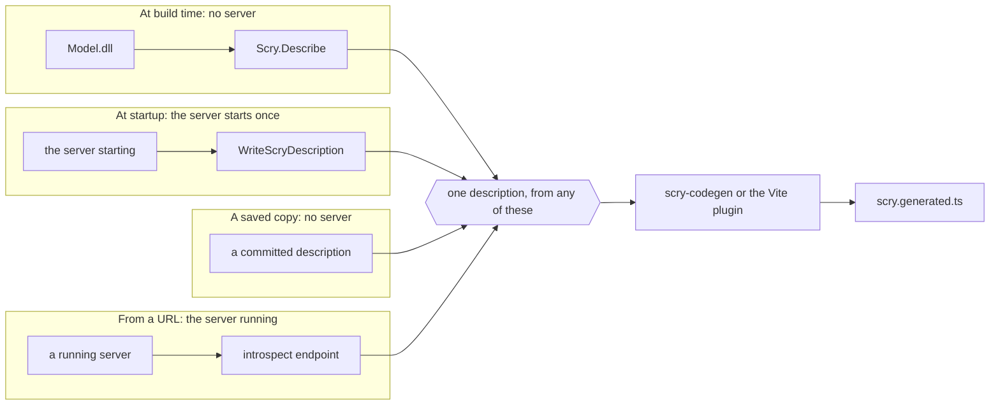

# Scry for TypeScript

The TypeScript client: a generator that writes typed models from a server's introspection, and a client whose queries are the C# client's bytes for the same query. [docs/typescript.md](../../docs/typescript.md) documents it, and `samples/Sample.TypeScriptClient` runs it against `Sample.WebServer`.

The package is private and unpublished.


## Generating a client

Generating needs a description of the server's surface, not a running server. That surface is the model's alone, read from its attributes as the C# client's generator reads them, so the description can be written from the model DLL as part of a build. `scry-codegen`, or the Vite plugin in `scry-client/vite`, reads it from any of these:

| Input | Needs the server running |
| --- | --- |
| The file `Scry.Describe` writes from the model DLL, as a step after the model compiles | No. The server never starts. `Sample.WebServer`'s build writes the TypeScript sample's this way. |
| The file a server writes as it starts, with `app.WriteScryDescription(path)` in Development | Only once, to write it. After that the server can be stopped. |
| Any saved copy, such as one committed beside the app | No. CI generates the sample's model this way, from the sample model's committed description. |
| The URL of a running server's introspection (`{explorer route}/introspect`) | Yes, while generating. |



```bash
npx scry-codegen --input ../Server/scry.description.json --output src/scry.generated.ts
```

Two values in a description are the server's configuration rather than the model's: the largest page it serves and the longest query it takes as a URL. A description written at build time is told them (`--max-page-size`, `--query-url-limit`) or takes the server's defaults; the client reads the URL limit only until the first response tells it the server's, and does not read the page size. [Generating the model](../../docs/typescript.md#generating-the-model) covers each way and the Vite plugin.


## Developing

Node 23.6 or later runs TypeScript as it is, so there is no build step.

```bash
npm ci
npm run check
```

`check` type-checks, which also runs the assertions in `test/types.ts`, and runs the tests. None of it needs a server: the tests read fixtures the .NET side keeps as snapshots in `src/Scry.Tests/TypeScript` (the wire vocabulary, the test model's description, the request corpus, and the HTTP exchanges each endpoint answers with), so a change there reaches this client as a failing test.

`test/server.test.ts` is the one exception, on purpose: an end-to-end run against a live `Sample.WebServer`. It generates the model from that server's introspection URL, to check it against what the server serves, and then sends real queries, streams, batches, live queries, commands and attachment fetches through it. It needs the server for that round trip, not for generating, and is skipped unless `SCRY_SERVER` names the server:

```bash
SCRY_SERVER=http://localhost:5249 node --test test/server.test.ts
```

`samples/Sample.TypeScriptClient/integration.ps1` runs the whole of it end to end, as CI's Windows job does after the suites: it builds `Sample.WebServer`, whose build writes the description, starts it, generates one client from the build's description, from the one the server writes as it starts, and from its introspection endpoint, and fails unless all three are the same. It then runs the sample, and these server tests, against it. It needs LocalDB, as the .NET suites do.

```powershell
./samples/Sample.TypeScriptClient/integration.ps1
```

What is generated for the two fixture descriptions is committed under `test/generated`. After changing the generator, or after the .NET side accepts a new description, write it again and review the difference:

```bash
npm run fixtures
```
