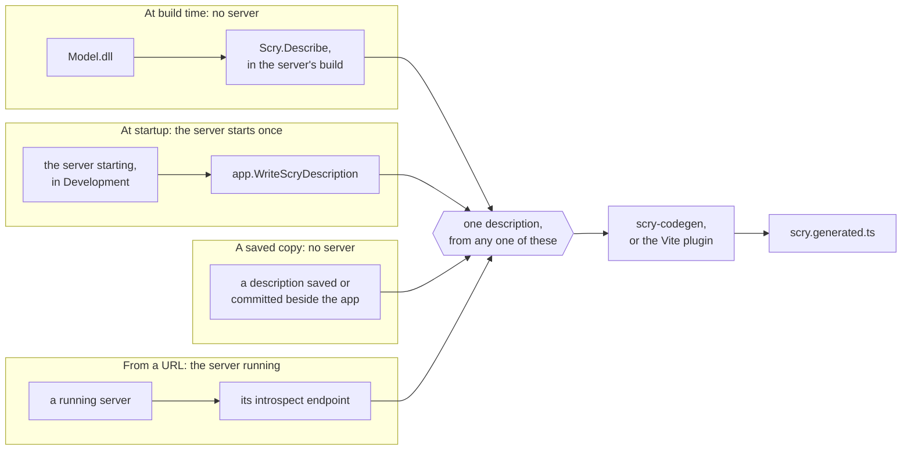
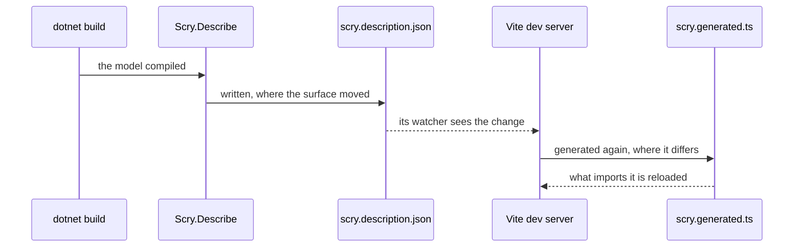

# TypeScript

Scry's C# client is generated from the model DLL, which only a C# project can read. The TypeScript client is generated from what the server already says about itself instead: the [introspection](explorer.md) description the query explorer reads, fetched from a running server or from a saved file. Nothing else stands between a TypeScript app and the server, and the model assembly is never referenced, as it is not from C#.

What it writes is the C# client's request for the same query, byte for byte, since the cache, the URL form and the audit all key off a request's bytes. Every query the `WireShapeTests` corpus records is written by both and the bytes compared, which match for all but three C# spellings the client's tests list with why, and every answer the corpus records is read back. The answers arrive as the types the query said, a `long` as a `bigint` and a `decimal` as its exact text, so nothing passes through a JavaScript number that cannot hold it.

It lives in `clients/typescript`, has no dependencies, and ships as TypeScript source: Node 23.6 or later runs it as it is, and a runtime that does not run TypeScript needs a step that compiles it. The package is private and unpublished, so an app depends on it by path, as the sample does. It reads queries, streams, batches, live queries, commands, binary parts and attachments over HTTP. The SignalR transport, the Blazor components and the [debug sidecar](sidecar.md) have no counterpart.


## The samples

Two TypeScript clients of `Sample.WebServer`: one on Node, and one in a browser, built with Vite. Building the server writes its description into both samples' folders, from the model DLL, so each client is generated before the server has ever started; running the server is for the queries.

### On Node

`samples/Sample.TypeScriptClient` is a console client, writing the queries `Sample.ConsoleClient` writes in C#:

```bash
dotnet build samples/Sample.WebServer
cd samples/Sample.TypeScriptClient
npm install
npm run generate
```

```bash
dotnet run --project samples/Sample.WebServer
```

```bash
cd samples/Sample.TypeScriptClient
npm start
```

| Command | Does |
| --- | --- |
| `npm start` | Prints the active employees, the order totals per region, and how many employees are active. |
| `npm start -- --live` | Watches the orders until Ctrl+C, printing the whole table each time it changes. |
| `npm start -- --reprice <id>` | Sends the `RepriceOrder` command and prints its outcome: the write to make in one terminal while another runs `--live`. |
| `npm start -- --photos` | Opens each employee's photo, an attachment no query carried. |
| `npm start -- --server <url>` | Points at a server other than `Sample.WebServer`. |

`npm run generate` writes `src/scry.generated.ts` from that description, as an app's build would; neither file is committed. CI writes the model from the sample model's committed description instead (`npm run generate:snapshot`) and type-checks the sample against it, which compiles every example on this page. It also runs `integration.ps1`, beside the sample, against a real server: one client generated from the description the build writes, from the one the server writes as it starts, and from its introspection endpoint, which have to be the same, then the samples and the client's server tests run against that server.

### In a browser

`samples/Sample.TypeScriptWeb` is the same queries as a page: the tables, each employee's photo drawn from the attachment handle its row came back with, and a live table of orders with a Reprice button on each row, enabled where the server says the row may be repriced. With the server running:

```bash
cd samples/Sample.TypeScriptWeb
npm install
npm run dev
```

The model is generated by the [Vite plugin](#with-vite), from the description the server's build wrote, and again whenever a build writes a new one. The page asks its own origin for `/api`, which Vite's dev server forwards to the server, so the page and the API share an origin and the server needs no cross-origin policy; live queries and pending commands stream through the forward:

<!-- snippet: typescriptWebViteConfig -->
<a id='snippet-typescriptWebViteConfig'></a>
```ts
export default defineConfig({
  plugins: [
    scry({ input: process.env["SCRY_DESCRIPTION"] ?? "scry.description.json", output: "src/scry.generated.ts" })
  ],
  server: {
    proxy: {
      "/api": process.env["SCRY_SERVER"] ?? "http://localhost:5000"
    }
  }
});
```
<sup><a href='/samples/Sample.TypeScriptWeb/vite.config.ts#L12-L23' title='Snippet source file'>snippet source</a> | <a href='#snippet-typescriptWebViteConfig' title='Start of snippet'>anchor</a></sup>
<!-- endSnippet -->

`SCRY_SERVER` points the forward at a server other than the one `Sample.WebServer`'s launch profile starts. The client is created with a path rather than a URL:

<!-- snippet: typescriptWebSetup -->
<a id='snippet-typescriptWebSetup'></a>
```ts
const scry = createScry<Sources>(schema, { transport: httpTransport({ endpoint: "/api/query" }) });
const commands = createCommands<Commands>(scry);
```
<sup><a href='/samples/Sample.TypeScriptWeb/src/main.ts#L10-L13' title='Snippet source file'>snippet source</a> | <a href='#snippet-typescriptWebSetup' title='Start of snippet'>anchor</a></sup>
<!-- endSnippet -->

An attachment's content is read as a blob, which is what an image shows:

<!-- snippet: typescriptWebPhotos -->
<a id='snippet-typescriptWebPhotos'></a>
```ts
async function showPhotos(): Promise<void> {
  const employees = await scry.employee
    .orderBy(_ => _.id)
    .select(_ => ({ id: _.id, name: _.name, photo: _.photo }))
    .toList();

  const photos = document.getElementById("photos")!;
  for (const employee of employees) {
    const figure = document.createElement("figure");
    const content = await employee.photo.open();
    if (content === null) {
      const none = document.createElement("div");
      none.className = "none";
      none.textContent = "no photo";
      figure.append(none);
    } else {
      const image = document.createElement("img");
      image.src = URL.createObjectURL(await content.blob());
      image.alt = employee.name;
      figure.append(image);
    }

    const caption = document.createElement("figcaption");
    caption.textContent = employee.name;
    figure.append(caption);
    photos.append(figure);
  }
}
```
<sup><a href='/samples/Sample.TypeScriptWeb/src/main.ts#L29-L58' title='Snippet source file'>snippet source</a> | <a href='#snippet-typescriptWebPhotos' title='Start of snippet'>anchor</a></sup>
<!-- endSnippet -->

Its test serves the page with Vite's dev server and drives it in Edge or Chrome, as installed, through `playwright-core`, which downloads no browser: the tables load, the photos are drawn, and a reprice reaches the live table. It runs in `integration.ps1`, against the server the script starts, after Vite's production build; CI's TypeScript job builds the sample from the committed description and type-checks it.


## Generating the model

The model is generated from a description of the server's surface: the [introspection](explorer.md#introspection) document the explorer reads. That surface is the model's alone, read from its attributes as the C# generator reads them, so the description can be written from the model DLL as part of a build, with no server started. A server can also write it as it starts, and a running server serves it. A copy of a description, saved or committed beside the app, serves as well as the one it was copied from. The generator needs one, from any one of these:



| Written by | When | Needs a server | Its limits |
| --- | --- | --- | --- |
| `Scry.Describe`, from the model DLL | As the server's build finishes, or any build step after the model compiles | No | As given to it, else the server's defaults |
| `app.WriteScryDescription(path)` | As the host starts, in Development | To start once | The ones the host configured |
| The explorer's `{route}/introspect` | Whenever it is asked | Running, while generating | The ones the host configured |

The limits are the two values a description carries that are the server's configuration rather than the model's: the largest page it serves (`maxPageSize`) and the longest query it takes as a URL (`queryUrlLimit`). The client reads the URL limit only until the first response tells it the server's, and does not read the page size.

### At build time

<!-- snippet: describeAtBuildTime -->
<a id='snippet-describeAtBuildTime'></a>
```csproj
<Target Name="WriteScryDescription" AfterTargets="Build">
  <MSBuild Projects="..\..\src\Scry.Describe\Scry.Describe.csproj" Targets="GetTargetPath">
    <Output TaskParameter="TargetOutputs" PropertyName="ScryDescribe" />
  </MSBuild>
  <PropertyGroup>
    <ScryModel>$(TargetDir)Sample.Model.dll</ScryModel>
    <ScryDescribeCommand>dotnet &quot;$(ScryDescribe)&quot; --model &quot;$(ScryModel)&quot; --max-page-size 200</ScryDescribeCommand>
  </PropertyGroup>
  <ItemGroup>
    <ScryDescription Include="..\Sample.TypeScriptClient\scry.description.json" />
    <ScryDescription Include="..\Sample.TypeScriptWeb\scry.description.json" />
  </ItemGroup>
  <Exec Command="$(ScryDescribeCommand) --output &quot;%(ScryDescription.FullPath)&quot;" />
</Target>
```
<sup><a href='/samples/Sample.WebServer/Sample.WebServer.csproj#L28-L43' title='Snippet source file'>snippet source</a> | <a href='#snippet-describeAtBuildTime' title='Start of snippet'>anchor</a></sup>
<!-- endSnippet -->

`Scry.Describe` reads the model DLL with the source generator's own reader, never loading it, and stamps it with the generator's own stamp, so what it writes is the description the server gives of the same model: `ModelDescriptionTests` compares the two byte for byte. It writes only where the description changed, whole and then moved into place, so whatever watches the file runs when the surface moved and never reads half of one. A model that is not there, that declares nothing a client could use, or that the generator would refuse, fails the step with what is wrong.

| Option | |
| --- | --- |
| `--model` | The model assembly the `[Queryable]` types are declared in. |
| `--output` | Where to write the description. |
| `--max-page-size` | `ScryOptions.MaxPageSize`, where the server sets it. |
| `--query-url-limit` | `ScryOptions.QueryUrlLimit`, where the server sets it. |

It is a project in `src` (`src/Scry.Describe`) and not yet a package, as the TypeScript client is not.

### At startup

```cs
app.MapScry("/api/query");
app.WriteScryDescription("../client/scry.description.json");
```

`WriteScryDescription` writes the document `{explorer route}/introspect` serves, less what only the explorer sets (whether it offers SQL), to a path resolved against the content root. It carries the limits the host configured, which a description written at build time is told. It writes in Development unless `always: true` is passed, since the description is the whole allow-listed surface, and as the build step does, only where the contents changed.

### Running the generator

```bash
npx scry-codegen --input ../Server/scry.description.json --output src/scry.generated.ts
```

| Option | |
| --- | --- |
| `--input` | The description: a file written by either of the above, or a saved copy of one, or the URL the explorer reads it from (`{explorer route}/introspect`, mapped in Development by default). |
| `--output` | Where to write the generated TypeScript. It is left alone where it already holds what the description generates. |
| `--runtime` | The module generated code imports the client's types from. Defaults to `scry-client`. |

A description from another introspection version is refused, as is a type display the generator does not know: generating against a newer server fails loudly rather than guessing. The generated file carries the description's schema stamp, which every request sends and every response is compared with, so a client generated against one model and talking to another is told so, once, through `onSchemaStale`.

### With Vite

An app built with Vite can have its build generate the model, as a C# client's build regenerates from the model on every compile. The plugin is imported from `scry-client/vite`:

<!-- snippet: typescriptVitePlugin -->
<a id='snippet-typescriptVitePlugin'></a>
```ts
export default defineConfig({
  plugins: [
    scry({ input: "scry.description.json", output: "src/scry.generated.ts" })
  ]
});
```
<sup><a href='/clients/typescript/test/vite/vite.config.ts#L8-L14' title='Snippet source file'>snippet source</a> | <a href='#snippet-typescriptVitePlugin' title='Start of snippet'>anchor</a></sup>
<!-- endSnippet -->

It generates the model as a build or the dev server starts, and in the dev server again whenever the description changes, which is whenever the server's build, or its startup, writes a surface that moved. So a change to the model reaches a running dev server's types with nothing restarted:



It writes a real file rather than a virtual module, since the type-checker and the editor read files. A description not there yet, on a machine where the server has not been built, keeps the generated file as it is with a warning, and fails the build only where there is no generated file either. `input` may also be a running server's introspection URL, read once as the build starts. Paths are relative to Vite's root.

The plugin is optional: `vite` is an optional peer dependency, and the client's own entry point imports nothing of it, so an app without Vite runs `scry-codegen` as before.

Per model, two interfaces:

- `{Type}Query`, what a query reads. Every member is an `Expr` of the value it holds, a navigation is `Optional` (every value read through it may be null), and a collection is a `Collection` asked about through a subquery. An attachment is an `AttachmentMember`, which a query may only return.
- `{Type}Row`, the row a query projecting nothing returns: the model's scalar members, a base's first, and an `Attachment` handle for each attachment.

Beside them: every enum the model names (a `[Flags]` one as `Flags`), a payload interface per command and the class its result is, `Sources` and `Commands` mapping each to its types, and `schema`, which says at run time what the types cannot: the name each member travels under, what each value is, and what a query projecting nothing projects.

| Server type | TypeScript |
| --- | --- |
| `bool` | `boolean` |
| `string`, `char` | `string` |
| `int` and the smaller integers, `uint`, `float`, `double` | `number` |
| `long`, `ulong` | `bigint` |
| `decimal` | `Decimal`, its invariant text |
| `Guid` | `Guid`, its text |
| `DateTime`, `DateOnly`, `TimeOnly`, `TimeSpan`, `DateTimeOffset` | Each as its round-trip text. A `DateTime` is a wall clock, so it is not a JavaScript `Date`. |
| `byte[]` | `Uint8Array` |
| `[Attachment] byte[]` | `AttachmentMember` in a query, `Attachment` in a row |
| An enum | A union of its names |
| `T?` | `T \| null` |

Introspection does not say whether a `string` or `byte[]` member may be null, so neither is typed as nullable, as the C# client's generated models do not mark them either. A command payload's nullable value may be left out.


## Connecting

<!-- snippet: typescriptClientSetup -->
<a id='snippet-typescriptClientSetup'></a>
```ts
const scry = createScry<Sources>(schema, {
  transport: httpTransport({ endpoint: `${server}/api/query` }),
  onSchemaStale: _ => console.warn(`Generated against ${_.client}, and the server is on ${_.server}: run npm run generate.`)
});
const commands = createCommands<Commands>(scry);
```
<sup><a href='/samples/Sample.TypeScriptClient/src/main.ts#L19-L25' title='Snippet source file'>snippet source</a> | <a href='#snippet-typescriptClientSetup' title='Start of snippet'>anchor</a></sup>
<!-- endSnippet -->

`httpTransport` sends to the endpoint `MapScry` was given, over `fetch`, and to the routes beside it for streams, batches, live queries, commands and attachments. Headers every request carries, such as an authorization, are given as an object or a function asked each time:

<!-- snippet: typescriptTransport -->
<a id='snippet-typescriptTransport'></a>
```ts
const scry = createScry<Sources>(schema, {
  transport: httpTransport({
    endpoint: "https://example.test/api/query",
    headers: () => ({ Authorization: `Bearer ${token()}` })
  })
});
```
<sup><a href='/samples/Sample.TypeScriptClient/src/examples.ts#L10-L17' title='Snippet source file'>snippet source</a> | <a href='#snippet-typescriptTransport' title='Start of snippet'>anchor</a></sup>
<!-- endSnippet -->

A request travels as a URL when it fits the server's budget and reads nothing sensitive, which lets a cache between the client and the server keep the answer, and as a body otherwise. The budget is learned from every response (`Scry-Url-Limit`). A URL refused before it reached the server (a 400, 404, 414 or 431 without that header) is asked again as a body, and nothing as long is asked as a URL again; a 405 turns the URL form off; a refusal saying the request must travel as a body is asked again as one. This is the C# client's behaviour.

`createScry` takes three more options. `defaultProjection: "server"` stops a query projecting nothing from naming the model's members, as a C# source built by hand does; `stamp: false` leaves the schema stamp off each request; and `retry` decides when a live query asks again ([Live queries](#live-queries)).


## Writing queries

<!-- snippet: typescriptQuery -->
<a id='snippet-typescriptQuery'></a>
```ts
async function showActiveEmployees(): Promise<void> {
  const rows = await scry.employee
    .where(_ => _.active)
    .orderBy(_ => _.name)
    .select(_ => ({ name: _.name, status: _.status, manager: _.manager.name, department: _.department.name }))
    .toList();

  writeTable(
    ["Name", "Status", "Manager", "Department"],
    rows.map(_ => [_.name, _.status, _.manager ?? "", _.department ?? ""]));
}
```
<sup><a href='/samples/Sample.TypeScriptClient/src/main.ts#L68-L80' title='Snippet source file'>snippet source</a> | <a href='#snippet-typescriptQuery' title='Start of snippet'>anchor</a></sup>
<!-- endSnippet -->

A member is read as a path, so `_.manager.name` is the `Manager.Name` the server reads, and a value read through a navigation may be null. Comparison, logic and arithmetic are functions (`eq`, `gt`, `and`, `not`, `add`, `coalesce`, `cond`, `concat`, `isIn` and the rest), as is every function the wire carries (`startsWith`, `year`, `addDays`, `round`, `toDouble` and the others):

<!-- snippet: typescriptWhere -->
<a id='snippet-typescriptWhere'></a>
```ts
const rows = await scry.employee
  .where(_ => and(_.active, eq(_.status, "FullTime"), startsWith(_.manager.name, "A")))
  .orderBy(_ => _.name)
  .select(_ => ({ name: _.name, manager: _.manager.name, department: { name: _.department.name } }))
  .toList();
// { name: string; manager: string | null; department: { name: string | null } }[]
```
<sup><a href='/samples/Sample.TypeScriptClient/src/examples.ts#L20-L27' title='Snippet source file'>snippet source</a> | <a href='#snippet-typescriptWhere' title='Start of snippet'>anchor</a></sup>
<!-- endSnippet -->

A collection is asked about through its own methods: `_.lines.any(l => gt(l.quantity, 1))`, `_.tags.contains("urgent")`. Grouping, joins and set operations follow LINQ's shape:

<!-- snippet: typescriptGroupBy -->
<a id='snippet-typescriptGroupBy'></a>
```ts
async function showRegions(): Promise<void> {
  const rows = await scry.order
    .groupBy(_ => _.region)
    .select(group => ({ region: group.key, total: group.sum(_ => _.amount), count: group.count() }))
    .toList();

  writeTable(
    ["Region", "Total", "Orders"],
    rows.map(_ => [_.region, _.total, String(_.count)]));
}
```
<sup><a href='/samples/Sample.TypeScriptClient/src/main.ts#L84-L95' title='Snippet source file'>snippet source</a> | <a href='#snippet-typescriptGroupBy' title='Start of snippet'>anchor</a></sup>
<!-- endSnippet -->

A terminal with a condition of its own takes it as LINQ's does:

<!-- snippet: typescriptCount -->
<a id='snippet-typescriptCount'></a>
```ts
async function showActiveCount(): Promise<void> {
  const active = await scry.employee.count(_ => _.active);
  console.log(`${active} active employees`);
  console.log();
}
```
<sup><a href='/samples/Sample.TypeScriptClient/src/main.ts#L98-L104' title='Snippet source file'>snippet source</a> | <a href='#snippet-typescriptCount' title='Start of snippet'>anchor</a></sup>
<!-- endSnippet -->

The types follow the server's pipeline grammar, so an ordering the server would refuse does not compile: `thenBy` follows an ordering, a grouped query projects, nothing filters after a projection, and a terminal's own condition comes before any projection. A row's type is inferred from the projection.

A constant is typed by what stands beside it, as C# would type it, so a query sends the bytes the same C# query sends: `gt(_.amount, 90)` sends `90` as a `Decimal` because `Amount` is one. A projected key travels with its first letter capitalized, as a C# member is named, and rows read back under the key as written.

JavaScript's own operators ask nothing of the server, since a member is an expression rather than a value. `>`, `+` and a template literal on one throw. `&&`, `||`, `!` and `? :` cannot be caught at run time: `where(_ => a && b)` would send `b` alone. Turn on `@typescript-eslint/strict-boolean-expressions` for code that writes queries.


## Reading answers

Each answer is read by a plan the query builds alongside its projection, so every value arrives as its type says:

- a `long` as a `bigint` and a `decimal` as its exact text, read from the number's own text rather than a JavaScript number;
- bytes as a `Uint8Array`, from base64 or, for a `[BinaryTransfer]` member, from the raw multipart part its placeholder names;
- an enum checked against the model, a value renamed since the client was generated mapped back through the aliases the response carries, and one with no name in the model failing as a stale client;
- each row keyed by the names the query wrote.

A refusal throws `ScryRequestError` with the server's status, `code` and message, and `ScryPermissionError` and `ScryStaleClientError` are told apart. A body cut off part way, an answer of another kind than the terminal asked for, or a placeholder naming a part the response did not carry throws `ScryWireError` rather than returning a short answer. `schemaStatus(scry)` says which stamps the client and the server are on.


## Streams and batches

<!-- snippet: typescriptStream -->
<a id='snippet-typescriptStream'></a>
```ts
for await (const order of scry.order.orderBy(_ => _.id).select(_ => ({ id: _.id, amount: _.amount })).stream()) {
  show(`${order.id}: ${order.amount}`);
}
```
<sup><a href='/samples/Sample.TypeScriptClient/src/examples.ts#L32-L36' title='Snippet source file'>snippet source</a> | <a href='#snippet-typescriptStream' title='Start of snippet'>anchor</a></sup>
<!-- endSnippet -->

`stream()` reads the rows a line at a time as the server writes them. A failure after the first row throws the error its status would have been, and a stream cut off before the server's closing marker throws `ScryWireError`, so a short read is never taken for the whole answer. Leaving the loop early closes the connection. A projection of `[BinaryTransfer]` members streams as multipart, each row's parts arriving immediately before it, and reads as any other stream does.

<!-- snippet: typescriptBatch -->
<a id='snippet-typescriptBatch'></a>
```ts
const batch = createBatch(scry);
const count = batch.add(_ => _.employee.count());
const names = batch.add(_ => _.employee.orderBy(_ => _.name).select(_ => ({ name: _.name })).toList());
await batch.send();

show(`${await count} employees, the first ${(await names)[0]?.name}`);
```
<sup><a href='/samples/Sample.TypeScriptClient/src/examples.ts#L40-L47' title='Snippet source file'>snippet source</a> | <a href='#snippet-typescriptBatch' title='Start of snippet'>anchor</a></sup>
<!-- endSnippet -->

A batch sends its queries as one request ([Batching](batching.md)). Each entry is answered as it would have been alone, so one refused entry rejects its own promise and the others resolve. A batch is sent once, and each entry is one query ended by its terminal.


## Cancelling

Every terminal that answers once, and `stream()`, takes `{ signal }` last, as each C# terminal takes a `CancellationToken`:

<!-- snippet: typescriptCancel -->
<a id='snippet-typescriptCancel'></a>
```ts
const signal = AbortSignal.timeout(5_000);
const active = await scry.employee.count(_ => _.active, { signal });
const first = await scry.employee.orderBy(_ => _.name).select(_ => ({ name: _.name })).page(20, { signal });
```
<sup><a href='/samples/Sample.TypeScriptClient/src/examples.ts#L51-L55' title='Snippet source file'>snippet source</a> | <a href='#snippet-typescriptCancel' title='Start of snippet'>anchor</a></sup>
<!-- endSnippet -->

An aborted signal abandons the request: the fetch stops, the server sees its connection close, and the terminal rejects with the signal's reason (a `TimeoutError` for `AbortSignal.timeout`). A signal already aborted sends nothing. The options come after the condition where a terminal has one, and take its place where it is left out, so `count({ signal })` counts every row; `page` takes them in place of the size or the cursor, as `page({ signal })`, `page(20, { signal })` or `page(20, cursor, { signal })`. A query sent with a signal is the same request, byte for byte, as without one.

A stream whose signal aborts ends with the reason, whether it was waiting for a row or holding one, rather than as a stream the server cut off. A query in a batch goes with the batch: the signal handed to `send` abandons it, and every entry rejects with the reason, while a signal handed to an entry's own terminal is not read. A live query ends when its loop is left or the function `subscribe` returned is called. A command's sender takes `{ signal }` too, as `send.repriceOrder(payload, { signal })`: it stops waiting, but once the server has answered it never stops the command, which goes on being followed as pending work ([Commands](#commands)). An attachment's `open({ signal })` abandons its fetch.


## Live queries

<!-- snippet: typescriptLive -->
<a id='snippet-typescriptLive'></a>
```ts
async function watchOrders(): Promise<void> {
  console.log("Watching orders. Ctrl+C to stop.");
  console.log();
  const orders = scry.order
    .orderBy(_ => _.id)
    .select(_ => ({ id: _.id, region: _.region, amount: _.amount }))
    .live();

  await new Promise<void>(resolve => {
    const stop = orders.subscribe(
      answer => {
        console.log(new Date().toLocaleTimeString());
        writeTable(["Id", "Region", "Amount"], answer.map(_ => [String(_.id), _.region, _.amount]));
      },
      error => {
        console.error(`The live query ended: ${(error as Error).message}`);
        resolve();
      });
    process.once("SIGINT", () => {
      stop();
      resolve();
    });
  });
}
```
<sup><a href='/samples/Sample.TypeScriptClient/src/main.ts#L109-L134' title='Snippet source file'>snippet source</a> | <a href='#snippet-typescriptLive' title='Start of snippet'>anchor</a></sup>
<!-- endSnippet -->

A [live query](live-queries.md) is one request answered whenever its answer changes. `live()` answers with the rows, and `liveCount`, `liveLongCount`, `liveAny`, `liveFirstOrDefault` and `liveSingleOrDefault` with the scalar:

<!-- snippet: typescriptLiveCount -->
<a id='snippet-typescriptLiveCount'></a>
```ts
const stop = scry.employee
  .liveCount(_ => _.active)
  .subscribe(
    active => show(`${active} active`),
    error => show(`The live query ended: ${(error as Error).message}`));
```
<sup><a href='/samples/Sample.TypeScriptClient/src/examples.ts#L60-L66' title='Snippet source file'>snippet source</a> | <a href='#snippet-typescriptLiveCount' title='Start of snippet'>anchor</a></sup>
<!-- endSnippet -->

A live query is an `AsyncIterable` that runs until the loop leaves it, and `subscribe` calls back until the function it returns is called. A connection that ends is asked for again naming the last answer held, so an answer that has not moved is not sent again, and the consumer sees a pause rather than an end. The server failing for the moment, a server-side limit on open subscriptions, a 5xx, 408 or 429 from something in between, and a failed connection are all asked again. A rejection, a denial, or a client the server calls stale ends the live query with its error, since asking again would not change the answer. The C# client follows the same rules.

The `retry` option of `createScry` decides how long to wait before asking again. It is told how many attempts have failed since the last answer, how long that has been, and why the last one failed, and it returns milliseconds, or `undefined` to stop. The default, `backoff`, asks at once, then after a second, doubling to thirty, with a fifth either way at random so that clients cut off together do not return together.


## Commands

<!-- snippet: typescriptCommand -->
<a id='snippet-typescriptCommand'></a>
```ts
async function repriceOrder(id: number): Promise<number> {
  const sent = await commands.send.repriceOrder({ id });
  if (sent.status === "Pending") {
    console.log(`Order ${id} is being repriced…`);
  }

  const outcome = await sent.completion;
  switch (outcome.status) {
    case "Completed":
      console.log(`Order ${id} repriced.`);
      return 0;
    case "Failed":
      console.error(`Order ${id} was not repriced: ${outcome.error}`);
      return 1;
    case "Unknown":
      console.error(`Whether order ${id} was repriced is unknown: ${outcome.error}`);
      return 1;
  }
}
```
<sup><a href='/samples/Sample.TypeScriptClient/src/main.ts#L140-L160' title='Snippet source file'>snippet source</a> | <a href='#snippet-typescriptCommand' title='Start of snippet'>anchor</a></sup>
<!-- endSnippet -->

`createCommands` takes the sources `createScry` made, and `send` holds one function per [command](commands.md) the model declares, typed by its payload and its result. A payload is written as a query's constant is, so a date may be a `Date` or its text, and a `[Flags]` value its names. It travels camel-cased, each value in the JSON type the server binds it from: a `long` and a `decimal` as numbers, every enum by its name. A member the command does not have, or a null it cannot hold, is refused before anything is sent.

| `status` | Means |
| --- | --- |
| `Completed` | Handled. `result` holds what the handler answered with, read as the model describes it. |
| `Failed` | Accepted and then not done: the handler refused or failed, or the target was gone by the time the command arrived. `error` is the reason the server showed. |
| `Pending` | Still being handled when the client stopped waiting. `completion` settles with the outcome, and meanwhile the command is listed in `commands.pending`. |
| `Unknown` | The connection it was answered on ended, and the server no longer holds its outcome or would not answer for it when asked again. It may have run. |

A refusal is not an outcome. A command the server would not accept (malformed, denied, one too many) never ran, so sending it throws, as a refused query does. Every outcome has a `completion`, which is the outcome itself where it is final and never rejects, and `resultOf` answers the result of a completed one, throwing `ScryCommandFailedError` otherwise:

<!-- snippet: typescriptCommandResult -->
<a id='snippet-typescriptCommandResult'></a>
```ts
const commands = createCommands<Commands>(scry);
await commands.ready;
if (!commands.can("createEmployee")) {
  return;
}

const hired = await commands.send.createEmployee({ name: "Ann", departmentId: 1, status: "FullTime" });
const { id } = resultOf(await hired.completion);
const deletable = await scry.employee
  .where(_ => eq(_.id, id))
  .select(_ => ({ name: _.name, deletable: _.canDeleteEmployee }))
  .single();
```
<sup><a href='/samples/Sample.TypeScriptClient/src/examples.ts#L71-L84' title='Snippet source file'>snippet source</a> | <a href='#snippet-typescriptCommandResult' title='Start of snippet'>anchor</a></sup>
<!-- endSnippet -->

The server answers at once where it decides a command within its sync window, and otherwise answers pending and streams the outcome on the same response. The client waits `wait` milliseconds (three seconds unless set; `Infinity` waits for the outcome) before answering `Pending`. A pending command's connection that ends first is asked for again by the command's id, under the `retry` policy live queries use. `commands.pending` lists each command from going pending until its outcome has been seen: a completed one leaves after `completedLinger` milliseconds (eight seconds unless set), and a failed or unknown one stays until `clearFinished()`, since it says something somebody should read. `onPendingChanged` says when the list moves. `close()` stops following, and each command still followed ends `Unknown`; the server finishes what it accepted either way.

`commands.can("createEmployee")` says whether this caller may send the command at all. It is `false` until the server has answered, which the first call starts; `ready` settles once it has, and `onCapabilitiesChanged` says when the answer moves. A denial asks again. Each targeted command also adds a `can{Command}` member to its target, decided on the server from the command's policy, which a query reads as it reads any member, as `deletable` above does. Both are advisory: the server decides again on every command.


## Binary members and attachments

A `[BinaryTransfer]` member's values travel as raw multipart parts beside the JSON, and read back as the `Uint8Array` a base64 one does, whether the answer was a list, a batch or a stream. Nothing about the query changes.

An [attachment](attachments.md) never travels with a query at all:

<!-- snippet: typescriptAttachment -->
<a id='snippet-typescriptAttachment'></a>
```ts
async function showPhotos(): Promise<void> {
  const employees = await scry.employee
    .orderBy(_ => _.id)
    .select(_ => ({ id: _.id, name: _.name, photo: _.photo }))
    .toList();

  const rows: string[][] = [];
  for (const employee of employees) {
    const photo = await employee.photo.open();
    if (photo === null) {
      rows.push([employee.name, "none"]);
      continue;
    }

    const bytes = await photo.bytes();
    rows.push([employee.name, `${bytes.length} bytes of ${photo.contentType}`]);
  }

  writeTable(["Name", "Photo"], rows);
}
```
<sup><a href='/samples/Sample.TypeScriptClient/src/main.ts#L164-L185' title='Snippet source file'>snippet source</a> | <a href='#snippet-typescriptAttachment' title='Start of snippet'>anchor</a></sup>
<!-- endSnippet -->

Each row comes back with a handle made from its key, and `open()` fetches the bytes from the attachment endpoint as a request of its own, which the server authorizes afresh. It answers `null` where the stored value is null, and throws `ScryRequestError` with status 404 where the server will not hand the bytes over: an absent row, one a policy hides and one the check refuses are answered alike. What it opens has the type the member declares, an advisory `length`, the `body` as it arrives, and `bytes()` and `blob()`, any one of which reads it.

A projection returns an attachment beside its row's key, as the one above does, or one navigation down, as `{ id: _.department.id, handbook: _.department.handbook }` does. The key is how the handle finds its row, so leaving it out throws when the query is written, as does filtering, ordering or grouping by an attachment, or carrying one through `distinct()`, a set operation or `selectMany()`. A handle holds only the source, the member and the key, so it outlives the response it came from.


## Developing the client

The client has no build step: Node 23.6 or later runs its TypeScript as it is.

```bash
cd clients/typescript
npm ci
npm run check
```

`check` type-checks, which also holds the assertions in `test/types.ts`, and runs the tests. None of it needs a server: the tests read fixtures the .NET side keeps as Verify snapshots in `src/Scry.Tests/TypeScript` (the wire vocabulary, the test model's description, the request corpus, and the HTTP exchanges each endpoint answers with), so a change there reaches the client as a failing test. A changed snapshot is accepted as any other is, and then the client made to agree.

`test/server.test.ts` is the one exception, on purpose: an end-to-end run against a live `Sample.WebServer`. It generates the model from that server's introspection URL, to check it against what the server serves, and then sends real queries, streams, batches, live queries, commands and attachment fetches through it. It needs the server for that round trip, not for generating, and is skipped unless `SCRY_SERVER` names the server:

```bash
SCRY_SERVER=http://localhost:5249 node --test test/server.test.ts
```

It writes to the sample's database, commands and a bulk reprice among them, so whatever reads the seeded rows after it reads them changed. `Sample.WebServer` builds its database afresh each time it starts.

`samples/Sample.TypeScriptClient/integration.ps1` runs the whole of it end to end, as CI's Windows job does after the suites. It builds `Sample.WebServer`, whose build writes the description, and starts it. It generates one client from the build's description, one from the description the server writes as it starts, and one from its introspection endpoint, and fails unless all three are the same. It then runs the console sample, drives the browser sample headless in Edge or Chrome, and runs the server tests, all against that server. It needs LocalDB, as the .NET suites do.

```powershell
./samples/Sample.TypeScriptClient/integration.ps1
```

What is generated for the two fixture descriptions is committed under `clients/typescript/test/generated`. After a change to the generator, or after the .NET side accepts a new description, write it again and review the difference as the generator change it is:

```bash
npm run fixtures
```
